# Docflow Architecture

## 1. Purpose and V1 boundary

Docflow is a production document-delivery SaaS. V1 serves diagnostic laboratories by detecting PDFs generated by an existing LIS and arranging delivery to a patient's WhatsApp number. Keep document ingestion and delivery behind replaceable interfaces so invoices/receipts/statements can be added later, but do not build invoice-specific features in V1.

The LIS remains the system that creates the PDF. Docflow does not generate or alter diagnostic results. Replies remain in the existing WhatsApp platform inbox; Docflow does not create a second inbox.

## 2. Components

- **Dashboard (`dashboard/`)**: Next.js App Router, TypeScript, Tailwind CSS and shadcn/ui. Manages tenant configuration and displays metadata. Never holds WhatsApp tokens or PDF bytes.
- **Control plane (`backend/`)**: Django + Django REST Framework. Authenticates users/devices; owns organizations, labs, branches, assignments, reports, attempts, status events and audits; resolves authorized account routing.
- **Windows Agent (`agent/`)**: Python Windows service; watches folders, waits for stability, validates PDFs and filenames, normalizes recipient, calculates content digest, persists jobs in local SQLite and coordinates upload/registration/recovery.
- **Docflow database**: Django-default SQLite during local development; PostgreSQL in production. Stores metadata only, never PDF bytes.
- **Durable send outbox/dispatcher**: Persists work before external dispatch. Redis/Celery may support wakeups, maintenance and analytics; the core delivery recovery design must not lose work if Redis is down.
- **Existing WhatsApp platform**: The known test path uses its developer API wrapper. It owns or uses the relevant WhatsApp credentials and Meta integration; the existing inbox handles replies. Production media/credential/status contracts remain open.
- **Temporary development uploader**: tmpfiles.org, only for fictional PDFs. Not a production component.

## 3. Data flows

```mermaid
flowchart LR
    LIS[Customer LIS] -->|writes PDF| Folder[Configured Windows folder]
    Folder --> Agent[Docflow Windows Agent]
    Agent -->|metadata only; no PDF bytes or media URL| Django[Django control plane]
    Django -->|create queued report| DB[(SQLite in dev / PostgreSQL in production)]
    Agent -->|temporary dev upload: fictional PDF only| Temp[tmpfiles.org]
    Temp -->|direct download URL| Agent
    Agent -->|attach validated media reference only| Django
    Django -->|uploaded state + attempt + outbox transaction| DB
    DB --> Outbox[(Durable database outbox)]
    Outbox --> Dispatcher[Server-side dispatcher / adapter]
    Dispatcher -->|approved account route + template| WA[Existing WhatsApp platform]
    WA --> Meta[Meta WhatsApp Cloud API]
    Meta --> Patient[Patient WhatsApp]
    WA -.->|status callbacks only when contract confirmed| Django
    Admin[Authorized administrator] --> Dashboard[Next.js dashboard]
    Dashboard -->|control plane APIs| Django
    Patient -.->|patient replies| Inbox[Existing platform inbox]
```

### PDF data plane

1. The LIS writes a PDF into a monitored folder.
2. The Agent waits for stable file size and modification time.
3. The Agent validates the PDF structure and parses the recipient phone number from the filename stem per `AGENT_SPEC.md`. The phone-bearing filename remains strictly local to the customer PC; it is never transmitted to Django or included in API registration metadata.
4. The Agent calculates SHA-256 and commits a durable local job in its local SQLite queue before network operations. Provider API acceptance alone (`accepted`) MUST NOT permit deletion of the local source PDF; the source PDF is retained on disk across all in-flight states (`queued`, `uploading`, `retrying`, awaiting delivery confirmation `delivered`/`read`, or reconciliation). Deletion is permitted only after confirmed delivery (`delivered` or `read`) or operator resolution of a permanent failure, followed by a finite configurable retention window.
5. The Agent first submits report metadata only to Django. Django authorizes the device, checks the active verified branch assignment (or development test verification override), idempotently creates a `queued` report and returns its report ID. No media URL, phone-bearing filename, or PDF bytes are part of this call. **Rationale for metadata-first sequencing:** Registering metadata before temporary upload establishes a durable report record and server-side tracking anchor in Django. This allows the Agent to obtain a stable report ID, recover gracefully if upload or reference attachment is interrupted, verify that an active sender assignment exists before expending upload bandwidth, and maintain an authoritative control-plane audit trail throughout the lifecycle.
6. **Development only:** The Agent uploads a fictional PDF directly to tmpfiles.org via `POST https://tmpfiles.org/api/v1/upload` (multipart form field `file`), extracts the direct-download binary URL (`https://tmpfiles.org/dl/...`), strictly rejects the HTML landing-page URL for WhatsApp payloads, enforces HTTPS and expected host (`TEMP_UPLOAD_EXPECTED_HOST=tmpfiles.org`), and computes an explicit `expires_at` timestamp based on conservative development TTL (`TEMP_UPLOAD_TTL_SECONDS=3600`). This timestamp is strictly a local operational estimate, not an upstream provider guarantee. It then calls the media-reference endpoint with the direct-download URL and explicit expiration timestamp. The URL must never be logged. No real patient data is allowed.
7. **Pre-send expiry validation, fetch failure & re-upload recovery:** Before a send attempt begins, the delivery system validates that the media reference is not expired or nearing expiry (`TEMP_UPLOAD_EXPIRY_BUFFER_SECONDS`). If expired or near expiry, or if the provider reports early fetch failure, the Agent re-uploads the retained local source PDF and attaches a fresh reference before dispatch proceeds. If the local file is missing/corrupt, the report fails closed with code `source_file_unavailable`. Temporary URLs are never used to reconstruct source files.
8. Django rechecks the server-side assignment and reference policy. In one transaction it stores the protected reference, changes `queued` to `uploaded`, creates the first attempt and durable outbox item. Django never fetches the URL or receives PDF bytes.
9. A server-side dispatcher/adapter calls the existing WhatsApp platform using the approved template, assigned account route, and standardized patient-facing attachment filename (`Diagnostic_Report.pdf`, never the patient's phone number).
10. State advances only on supported evidence: API acceptance, trusted status callback or explicit reconciliation result. An ambiguous send timeout transitions to `reconciliation_required`; no blind resend. Even if temporary media expired during reconciliation, the earlier attempt must be reconciled before resending.
11. **Cleanup eligibility & lifecycle:** When delivery is confirmed (`delivered`/`read`), the Agent arms a configurable retention timer (`AGENT_CLEANUP_RETENTION_HOURS`, default 24h; clock starts on delivery confirmation). Failed/quarantined reports are retained for `AGENT_FAILED_RETENTION_DAYS` (default 14d; clock starts on transition to `failed`/`quarantined`) for operator triage before cleanup. Retries cancel previous cleanup eligibility; operator hold suspends cleanup indefinitely across service restarts. Only after the retention timer elapses and pre-deletion verification confirms no active leases, retries, holds, or unresolved operations, does the source PDF undergo best-effort file deletion. Windows Agent host storage should have full-disk encryption (BitLocker) enabled. State is persisted in SQLite across service restarts.

**Production gate:** PDF upload must continue to bypass Django. The intended design requires the Agent to upload directly to an approved media destination using a narrowly scoped, secure mechanism without embedding global platform credentials (`WA_PLATFORM_DEVELOPER_TOKEN`) or long-lived customer account tokens in the Agent. Evaluated production options include:
- Official platform media-upload endpoint with scoped upload tokens.
- Docflow-owned private object storage (e.g. S3/GCS) with short-lived presigned upload URLs (issued by Django, uploaded directly by Agent, retrieved by provider via short-lived download grant).
If the external platform cannot support direct upload that meets Rule 4, stop and surface the architecture conflict rather than silently proxying PDF bytes through Django.

### Control plane

- Administrators create organizations/labs/branches, verify account assignments and activate devices.
- One-time activation codes bind a new Agent to a pre-created device and branch.
- Device requests use a revocable device-specific credential. Django derives tenant scope from the authenticated device.
- Heartbeats provide version/health/last-seen metadata. Configuration is returned only for the device's own branch.
- Reports and delivery states are metadata. Do not upload/store PDF content in Django or database fields.

## 4. WhatsApp routing

The assigned branch maps to a verified WhatsApp account under the same organization. The Agent never supplies `phone_number_id`, access token, WhatsApp account ID, organization ID or branch ID as authority to choose the sender. Django resolves the account from server-side assignment.

The platform developer confirmed accounts have different phone-number IDs and access tokens. A development send was tested against `https://wa.kizieemedia.com/api/developer/v25.0/{PHONE_NUMBER_ID}/messages` using a backend-held global developer token. This does not yet prove how credentials are provisioned, whether the global wrapper token is authorized for every customer ID, or how production media is uploaded. See `WHATSAPP_ADAPTER.md` and `OPEN_QUESTIONS.md`.

## 5. Runtime and deployment

- Local backend: SQLite; no separate database service required.
- Production backend: PostgreSQL selected through production settings/environment variables. Unsafe/missing required configuration must fail closed.
- Agent: independent SQLite queue on each Windows PC. It is not the backend database and must not contain PDF bytes or WhatsApp tokens.
- Redis/Celery: optional for maintenance, monitoring, analytics, cleanup and waking dispatch work. Persisted state/outbox plus recovery are authoritative.
- Containers/Nginx are anticipated for deployment, but exact implementation must be validated/documented before deployment work.

## 6. Reliability principles

- Commit local job state before network actions.
- File watcher events may duplicate; deterministic fingerprints/idempotency prevent duplicate sends.
- A send timeout may occur after provider acceptance. Mark `reconciliation_required` and use supported evidence before resend. Never assume timeout means failure.
- Status callbacks may be delayed, duplicated or out of order. Process idempotently and allow a later `delivered`/`read` callback to advance when earlier callbacks were missed.
- API acceptance is not delivery. Only trusted status evidence proves `sent`, `delivered` or `read`.
- Invalid/untrusted files are quarantined for review and never auto-sent.

## 7. Trust boundaries

- The Agent PC is not trusted to choose tenant/account routing.
- Public temporary hosting is untrusted for privacy; development-only and fictional-data-only.
- Dashboard browsers are untrusted; backend repeats authorization.
- Existing WhatsApp platform is an external dependency; keep integration behind an adapter.
- Tokens and public download URLs must not appear in logs, exception text or dashboard payloads.
